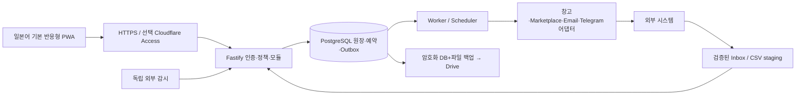

# 시스템 구조

DEV00 설계 기준선. React + TypeScript/Vite/Tailwind 웹, Node.js 24 LTS + Fastify API,
별도 Node Worker, PostgreSQL 17 + Drizzle. pnpm 10 workspace(DEV01에서 정확한 patch/packageManager/lock 고정).
ARM64 Linux 지원. DB 한 개의 modular monolith; broker/Redis/Kubernetes는 기본에 없음.
프런트·API·Worker는 배포 프로세스가 다르나 하나의 릴리스/스키마를 공유한다.

## 저장소·의존 방향 (DEV01 구현)
`apps/web`, `apps/api`, `apps/worker`, `packages/domain`, `packages/db`, `packages/contracts`,
`packages/integrations`, `infra`, `tests/{unit,integration,fault,e2e}`.
도메인은 외부 SDK/HTTP에 의존하지 않는다. API/worker는 같은 application command를 호출한다.
다른 모듈 테이블을 직접 수정하지 않고 public command/query port를 사용; 동시 트랜잭션은 공유 UnitOfWork로 묶는다.
통합 이벤트는 커밋된 outbox만 발행, 순서 역전은 version/sequence로 감지한다.
모듈별 입력/출력·데이터 소유권·오류·테스트 port는 [계약](docs/contracts/MODULES.md)에 정의한다.

## 공통 API 계약
`/api/v1`; JSON, UTC RFC3339 시각/UUID, bigint 수량·금전은 JSON decimal 문자열.
GET 목록 `{items,nextCursor,asOf}`; 기본 25/최대100. client sort/filter allowlist·schema 검증.
오류 `{code,messageKey,requestId,retryable,details}`; 비밀/stack/PII 노출 금지.
401 인증,403 권한,404 없음,409 버전/멱등 payload 충돌,422 수량/전이/매핑,429 제한,503 DB/신뢰 불가.
모든 변경은 세션+CSRF+RBAC; 위험 command는 `Idempotency-Key`, `If-Match` 버전,
actor와 canonical payload hash. 같은 key+같은 hash는 저장된 결과, 다른 hash는409.
DB commit 직전 실패는 rollback; commit 후 응답 유실은 같은 key 조회로 회복. key는 운영 재실행 기간 동안 tombstone 유지.

예: `POST /outbounds` → draft와 version; `POST /outbounds/{id}/reserve` → 원자 예약;
`POST /approvals` → 대상 ID/version/hash/한도; `POST /approvals/{id}/decide` → 일회성 결정;
`POST /outbounds/{id}/dispatch-instruction` →202 outbox ID, 실제 shipped 아님.
`POST /receipts`와 `POST /shipment-evidence`는 독립 증거, `POST /adjustments`는 조정 승인.
대량 CSV는 upload→staging 검증/미리보기→별도 승인 commit(행별 오류, 원본 hash, 중복 batch 차단).
서버는 보유량/최신성/권한을 다시 검사하며 클라이언트 계산을 신뢰하지 않는다.

## 비동기 계약
DB scheduler unique `(job_type,scope,scheduled_for,policy_version)`; worker `FOR UPDATE SKIP LOCKED`,
lease/fencing token·heartbeat, 최종 update는 lease owner/token 일치 조건. DB 시간 기준.
원장/상태/감사/outbox는 같은 트랜잭션; 네트워크 호출은 DB lock 밖.
Read-only sync는 exponential backoff+jitter/Retry-After/최대5회, 이후 dead-letter+알림.
원격 부작용은 idempotency 지원이 증명된 경우 동일 remote key로만 재시도.
이메일/provider 불명 결과는 `unknown`으로 격리: lease 만료/정전만으로 pending 복구 금지.
Inbox `(provider,external_event_id)` unique; ID 없으면 검증된 message-id/hash로 중복 후보 격리.
Sync fetch와 업무 전이를 분리; 서명·스키마·시간·mapping·sequence 검사 후 적용, 역순 이벤트는 상태 후퇴 금지.
외부 장애는 해당 integration circuit breaker만 개방. DB 장애 시 안전 변경 불가(503).

## 웹·PWA
Dashboard, Products, Inventory, Warehouses, Inbound, Outbound, Transfers, Procurement, Analytics,
Automation, Approvals, Activity Logs, Integrations, System Health, Settings를 라우트 경계로 정의.
일본어 locale key/ICU 메시지, 숫자·통화·Asia/Tokyo 표시(저장은 UTC), ko/en 확장.
오프라인은 정적 shell만 캐시. 인증 응답/PII/변경 command는 service worker에 캐시·queue 하지 않는다.
중복 클릭 UI 잠금+서버 멱등, 작업 진행/최종/불명 상태, 최신 sync 표시. 자동 저장은 draft와 화면 상태에 한정;
승인·출고·재고 확정은 서버 확인 필요. reconnect 후 최신 version 로드, 오래된 탭 내용 재승인 금지.
AI adapter 기본 disabled, 읽기 전용 분석 제안만; domain/worker 운영 경로에 AI 의존 없음.

재시도 기본: connect timeout5초/read30초, 읽기 재시도 full jitter `min(60초, 1초×2^attempt)`,
최대5회(총횟수), Retry-After가 더 길면 앞당기지 않고 다음 스케줄에 반영. provider별 승인된 정책 override.
서명·권한·payload 오류는 retryable=false. 토큰 refresh는 한 번만, 실패 후 운영자 재인증.
외부 쓰기의 결과불명은 이 읽기 재시도 정책을 적용하지 않는다.

## DEV01 구현 현황
예정 구조를 실제 workspace로 구현. 추가 `packages/runtime`은 config/log/shutdown 공유이며 domain과 분리.
구체 API/Worker/PWA·migration·소스/빌드 exports는 [개발 계약](docs/DEVELOPMENT.md).
DEV01 시점에는 읽기전용 health/version만 실행했다. DEV02는 인증 command를 추가하며 물류 command/원장/Outbox는 후속 범위다.

## DEV02 인증 모듈

`apps/api/src/auth`는 인증 application service/HTTP adapter, `packages/db/src/auth-schema.ts`는 저장 모델,
`packages/contracts`는 비밀 없는 AuthenticatedIdentity/IdentityProvider 계약을 소유한다.
행 잠금·인증·현재 Permission 검사·변경·audit를 하나의 UnitOfWork로 묶는다. 공유 풀은 기존 db package가 제공한다.
복잡한 replay/locking 쿼리는 parameterized PostgreSQL, ORM schema/snapshot/migration은 Drizzle을 사용한다.
웹 AuthGate는 보호 UI/만료/오프라인/다중 탭을 담당하며 API의 권한 검사를 대체하지 않는다.
실제 [인증 흐름·API·확장 경계](docs/AUTHENTICATION.md). Worker는 사람 세션과 독립된 읽기 전용 기반을 유지한다.

## DEV03 현재 구현

CatalogService는 AuthService의 실제 UoW/session/grant/CSRF/audit를 재사용한다. Domain catalog는 framework-free, DB는 forward migrations/constraints, HTTP adapter는 schema/DTO, 웹은 서버 metadata만 표시한다. 외부 네트워크 부작용은 없다.
[Catalog 상세 계약](docs/CATALOG.md). 실제 결과는 [DEV03 보고](docs/dev-reports/DEV-03.md)에서 확인한다.

## DEV04 현재 작업

불변 복식 재고 원장·예약·증거·부분 입출고·이동·정정·대조를 기존 Catalog/Auth UUID에 연결한다. 내부 구현·로컬 검증을 완료했다. GitHub 병합은 연결된 실제 PR 결과로 별도 판정하며 운영 배포가 아니다. [구현 계약](docs/INVENTORY_LEDGER.md) · [실제 검증/미실행 범위](docs/dev-reports/DEV-04.md). 미검증 수동/외부 증거와 위험 조정은 보류한다.
