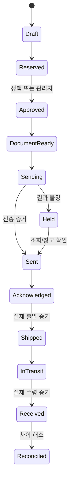

# 업무·자동화 운영 규칙

모든 흐름은 DEV04 이후 구현할 설계다. 실제 이메일/출고/구매는 현재 실행하지 않는다.

## 외부 창고 → FBA/RSL
1. 상품 매핑, source good/예약, destination의 신뢰된 판매가능량과 최신 sync를 조회.
2. 보충 제안 저장, 정책 버전/데이터 시각/수량·목적지·입고계획을 snapshot hash로 고정.
3. 창고 재고를 원자 예약; normal 한도 내면 정책 승인 기록, 한도/이상은 관리자 승인 대기.
4. 실제 marketplace 입고계획/배송 라벨 등 필요한 정보를 확인(미권한이면 수동 증거 입력).
5. `TemplateRenderer.render(templateId,version,validatedDTO)`로 Excel/PDF 생성, hash·sample 여부 저장.
   업체 양식 미확보 상태에서는 샘플 워터마크/발송 disabled. 수식 주입·CSV formula injection 및 PDF active content 방지.
6. 서버가 승인 hash/version과 문서·주소·첨부·금액/수량 한도를 재검사, outbox 한 번 enqueue.
7. 전송 시 `sending` commit 후 네트워크 호출. provider 확인되면 sent, 불명확하면 unknown+held.
8. warehouse ack는 요청 접수 증거일 뿐; 별도 실제 출고 증거의 SKU/수량/운송정보를 검증 후 good→transit.
9. 수령 증거를 받아 transit→destination good/damaged, 차이는 reconciliation. 모두 확인 후 reconciled.
10. 모든 단계 actor·시각·원본 evidence 참조·출처·내용 version·audit 저장; Telegram 알림은 독립적.

부분 출고/수령은 [모델](DATA_MODEL.md)의 line 이벤트로 처리한다. 그림의 직선 흐름이 누락 증거를 자동 확정하는 규칙은 아니다.

## 불명 결과와 수동 대안
메일 lost ACK/재시작은 Message-ID/업체 발송함 조회 및 창고 확인으로 해결. Message-ID는 중복방지 보장이 아님.
같은 요청을 새 ID로 자동 재발송하지 않는다. 명시적 미전달 증거+관리자 승인 후에도 동일 업무 참조로만 재개.
예상 외 회신은 자동 파싱 결과를 재고에 적용하지 않고 quarantine→관리자 매핑·수량 검토.
CSV는 source/observed_at/hash/행번호를 유지, 합계/중복/음수/미매핑 검사 후 미리보기·승인; 실제 확인 없는 숫자 보정 금지.
재고 snapshot의 관측 시점 이후 원장 거래가 있으면 차이 추정을 덮어쓰지 않고 동일 cutoff 대조.

## 보충과 추가 매입
보충: `net_position = trusted_destination_available + unique_confirmed_incoming − unallocated_demand`.
confirmed incoming은 transport/accepted plan/예약 출고 중 같은 inbound intent의 가장 진전된 단계 **한 번만** 합산.
`target = ceil(forecast_daily × (lead_days + review_days) + safety_units)`;
`proposed = min(max(target−net_position,0), source_available, policy_max)`.
목적지 reserved가 available에 이미 반영됐으면 재차 차감 금지. 계획의 active 예약도 source_available에서 이미 제외.
판매추세는 시간창/품절일 보정/이상치 규칙 version과 함께 설명; 신뢰 부족 시 자동화 보류.
기본 freshness 임시 정책: marketplace 재고/판매15분, 외부 창고 확인24시간, FX24시간.
실제 provider 지연/SLA가 불충족하면 자동화를 켜지 않고 운영자별 threshold 승인(설정 변경 감사).
다른 제안/실행이 동일 공급량을 쓰면 같은 lock/key에서 재계산, stale approval 무효화.

재발주: 공급처 납기+수입/통관+운송 기간, MOQ/발주 단위 반올림, cash budget,
원가·관세·운임·세금·보수적 판매예측으로 제안. MOQ로 예산 초과하면 자동 축소 구매가 아니라 hold.
DEV10은 제안/승인 계획까지; 실제 계약·결제 adapter는 별도 명시 승인 범위 없으면 구현하지 않는다.
JPY는 소수0, USD 등 통화 exponent 표; 개별 원가/세금은 exact Decimal로 계산하고 최종 최소단위로 명시 반올림
(기본 half-up, 공급처/세법이 다른 경우 version). 세금 포함/별도·원가 배부·환율 출처/시점 고정.
수익=확정 매출−환불−판매/FBA/RSL 수수료−확정 원가−배부 운임/관세/세금;
미확정 수수료/환율은 estimated로 별도 표시, 통화 섞어 합계 금지.

## 승인 정책
권한: viewer(read), operator(draft/재고 증거 입력), approver(한도 내 승인), admin(위험 설정), system(명시 작업별 최소 권한).
자동 실행은 verified mapping+fresh data+일치 원장+정상 수량+허용 목적지+정책 내에서만.
초기 운영은 automation disabled, 소량 staging 및 관리자 지정 한도 후 단계적 활성화.
금전 계약/결제, 정책상 대량, 이상 조정, 수동 미전달 재전송, 통합 endpoint 변경은 사람 승인.
승인 요청은 target/version/hash/policy/amount/currency/expiry/nonce에 결합.
내용/목적지/수량/첨부/정책 변경 시 폐기; 승인자 권한은 실행 시에도 확인.
self approval은 위험 작업 금지. 단독 운영자는 별도 re-auth+대기시간+한도 예외 정책을 명시 승인하고 감사;
2인 승인 정책을 가짜 사용자로 우회하지 않는다. Telegram 한 번 탭은 낮은 위험만, 고위험은 웹 MFA/re-auth.
일일 요약/정상 개별 알림 선택; 장애/불명/보안/백업은 긴급, 알림 실패 자체는 업무 성공으로 표시하지 않는다.
