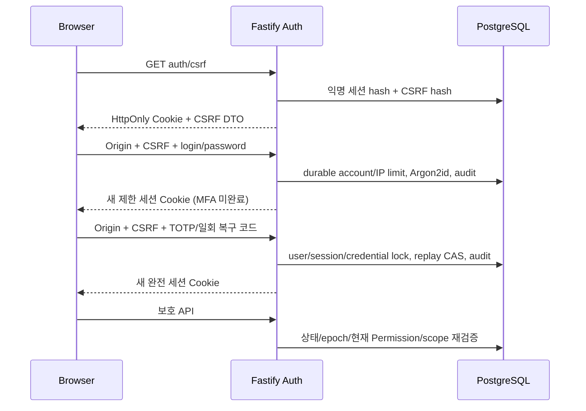

# DEV-02 인증 구현 계약

이 문서는 현재 개발·합성 테스트 환경의 구현을 설명한다. 운영 HTTPS/Ingress/DB 최소권한/키 보관/Pi 검증은 DEV12,
오프디바이스 감사 보존·복원은 DEV13이다. NODE_ENV=production 및 비-loopback bind 차단은 유지한다.

## 신뢰 경계

비밀번호만으로 관리 세션을 만들지 않는다. 미등록 사용자는 enroll/confirm만 거쳐 완전 세션을 얻는다.
관리자를 포함한 현재 모든 사용자에게 TOTP 또는 일회 복구 코드 검증을 요구한다.
비밀번호 단계의 제한 세션은 5분 만료, 완전 세션은 idle30분/absolute12시간이다.
로그인·MFA 완료·재인증·MFA 교체 시 식별자를 교체하고 이전 토큰을 폐기한다.

## 자격증명 및 설정

- 로그인 ID: trim + ASCII lowercase, `[a-z0-9][a-z0-9._@+-]{2,63}`. Unicode 유사 문자 거부.
  표시 이름은 별도 1–100자, React text로 escape. 비밀번호 자체는 정규화하지 않는다.
- 비밀번호: 최소14 code point/최대128 UTF-16 code unit/512 byte; Argon2id v19, 19,456KiB, time3, parallelism1.
  프로세스당 해싱·검증 최대2개, 무제한 큐 없음. 알 수 없는 ID도 같은 파라미터의 공유 dummy hash를 검증한다.
- @node-rs/argon2 2.2.2(MIT, napi-rs/node-rs): Node24 Linux x64 실제 실행, Linux ARM64 GNU/musl·Windows x64/ARM64·macOS ARM64 optional binary metadata 확인.
  OTPAuth9.5.2(MIT, hectorm/otpauth): 실제 TOTP 등록/검증. 2026-10-16 pnpm audit에서 알려진 취약점0.
  패키지 제공 여부는 해당 OS/CPU에서의 실제 실행 증거가 아니다. Pi·Windows·macOS 실기기 NOT RUN.
- TOTP: SHA1/6자리/30초, ±1 step만 허용. credential row lock과 증가하는 last_step으로 같은/이전 step 재승인 거부.
- MFA Secret: Node crypto AES-256-GCM, 매번 새 96-bit nonce + user UUID AAD. 등록 중 Secret도 암호화.
  AUTH_ENCRYPTION_KEY는 별도 32-byte Base64 키. 키 변경 시 과거 ciphertext는 복호화되지 않으므로 무계획 재생성 금지.
- 복구 코드: 128-bit CSPRNG 10개, SHA256만 저장. 원문은 등록/재발급 응답 또는 로컬 CLI에서 딱 한 번 표시.
  UPDATE ... consumed_at IS NULL RETURNING으로 일회 소비. 복구 코드와 TOTP 모두 MFA 계정/IP 제한 적용.
- 토큰: 256-bit CSPRNG Base64URL, 서버에는 SHA256만. JWT/localStorage/sessionStorage에 인증 토큰 없음.
- Cookie: Path=/api, HttpOnly, SameSite=Strict. loopback 개발 HTTP만 Secure 예외; HTTPS origin이면 Secure.
  실제 외부 HTTPS 운영 설정은 아직 지원/검증된 운영 환경이 아니다.
- AUTH_ORIGIN은 정확한 loopback browser origin. 개발 기본127.0.0.1:5173, 테스트4173.
  DB_SECRET/key는 VITE_ 환경변수나 웹 번들에 주입하지 않는다. 누락이면 auth503, health는 계속 분리 동작한다.

## 세션·CSRF·권한

모든 세션 조회는 PostgreSQL 시간 기준 만료/revocation/user status/epoch를 검사하고 user row를 잠근다.
역할을 장기 캐시하지 않는다. 권한 회수는 기존 세션에서도 다음 요청에403, 계정 비활성·비밀번호/MFA 변경·전체 세션 회수는 epoch로401이다.
재인증은 비밀번호+새 TOTP, 5분 미만에만 중요 변경 허용. 정확히5분이면 거부한다.

변경 요청은 Origin 정확 일치 + 해당 서버 세션에 연결된 CSRF hash 비교를 모두 요구한다.
GET csrf는 CSRF 값을 새로 발급하므로 동시 탭의 오래된 CSRF 요청은403일 수 있다. UI는 각 변경 직전 새 값을 조회하고,
실패한 POST를 자동 재시도하지 않는다. SameSite만으로 검사를 대신하지 않는다. CORS wildcard/credential 임의 origin 허용 없음.
신뢰 프록시 기본 off, X-Forwarded-For를 IP 권한 근거로 쓰지 않는다. 실제 proxy 정책은 DEV12에서 지정한다.

API namespace `/api/`에 새로 등록한 경로는 권한 선언이 없으면 기본401이다.
추가 업무 경로는 `config.wmsPermission`/`wmsRecentReauth`로 guard를 선언하고,
실제 변경은 `AuthService.mutate(ctx, callback, permission)`의 동일 transaction 안에서 정책을 다시 평가한다.
pre-handler 허가만으로 transaction 밖의 쓰기를 허용하지 않는다. `readSession/require/allowed`는 DEV03 이후 공유 경계다.
비-API 정적 자원은 인증 경계 밖이며 실제 업무 endpoint는 반드시 `/api/v1` 안에 등록한다.
기존 health/version만 명시적 비민감 공개 GET이다. 테스트의 일회 오류 probe는 운영 endpoint가 아니다.

### 역할

| 역할 | 현재 Permission 의도 |
|---|---|
| Administrator | 사용자·역할·감사·시스템·설정 및 정의된 업무 Permission 전체 |
| Manager | 시스템 조회, 상품 읽기/쓰기, 재고 읽기/조정, 출고 조회/생성/승인, 매입 조회 |
| Operator | 시스템/상품/재고/출고 조회, 출고 생성 |
| Viewer | 시스템/상품/재고/출고/매입 조회 |
| Auditor | Viewer 조회 범위 + audit.read |

정확한17개 Permission은 `apps/api/src/auth/policy.ts`와 서버 roles 응답이 기준이다.
업무 Permission 정의는 실제 재고/출고/매입 API 구현을 의미하지 않는다.
user_roles 활성 grant unique + FK + policy version 검사. 자기 자신의 역할 수정은403.
마지막 활성 MFA 관리자를 비활성/잠금/MFA 제거/권한 회수할 수 없다. 해당 변경은 advisory lock으로 직렬화한다.
창고가 없는 DEV02에서는 DB CHECK(scope='global'), API는 warehouse scope 입력을 거부한다.
PolicyEvaluator는 알려지지 않은 warehouse를 항상 deny. DEV03에서 warehouse_id FK와 global/warehouse 일치 CHECK,
scope별 active unique index, 실제 WarehouseResolver를 forward migration으로 추가한다. 가짜 창고 권한을 만들지 않는다.
Worker는 browser session을 요구하지 않으며 별도의 제한된 SystemActor 계약만 정의했다. 기존 읽기 전용 동작 유지.

## API

모두 `/api/v1` prefix. 오류는 공통 `{code,messageKey,requestId,retryable,details:null}`.
400입력/401인증/403권한·재인증/404대상 없음/409상태 충돌/429제한/503필수 보안 의존성 장애.
응답·로그에 password/hash/세션 토큰/SQL/stack/Secret/Cookie를 포함하지 않는다.
예외: enroll의 새 Secret과 confirm/recovery의 새 복구 코드는 소유자에게만 no-store 단발성 응답한다.

| Method/path | 입력 | 서버 정책 / 출력 |
|---|---|---|
| GET auth/csrf | 없음 | 익명/현재 세션, csrf; cookie 발급 가능 |
| POST auth/login | login,password | Origin/CSRF/rate; MFA 또는 enroll 제한 세션 |
| POST auth/mfa/verify | code,recovery? | 제한 세션, 계정/IP 제한/일회 factor, 완전 세션 |
| GET auth/me | cookie | 완전 세션, identity/roles/permissions/expiresAt |
| POST auth/logout | {} | 익명·제한·완전 세션의 CSRF 검증 후 서버 폐기 |
| POST auth/reauth | password,code | 완전 세션, 새 factor, 세션 rotation |
| POST auth/mfa/enroll | {} | 본인, 기존 MFA이면 최근 재인증; 새 등록 URI/Secret |
| POST auth/mfa/confirm | code | 등록 검증·암호화 credential 교체·epoch 회수; 새 복구 코드 |
| POST auth/mfa/recovery | {} | 최근 재인증, 복구 코드 재발급(기존 코드 무효) |
| POST auth/mfa/disable | {} | 최근 재인증, 마지막 관리자 보호, 기존 세션 회수 |
| POST auth/password | password | 최근 재인증, password hash 변경·전체 세션 회수 |
| POST auth/sessions/revoke | {} | 최근 재인증, 본인 모든 세션 회수 |
| GET users / roles / audit-events | limit?,cursor? | users.read / roles.read / audit.read; 기본25/최대100 |
| POST users | login,password,displayName,locale | users.manage + 최근 재인증; 역할 없는 사용자 생성 |
| PATCH users/:id | status?/displayName?/locale? | users.manage + 최근 재인증, epoch 변경 |
| PUT users/:id/roles | roles[] | roles.manage + 최근 재인증, self 변경 거부, 마지막 관리자 보호 |

모든 JSON은 additionalProperties:false, ID/locale/길이/배열 unique/페이지 크기를 검증한다.
일반 사용자 생성에는 공개 가입/고정 초기 비밀번호/무인증 복구 경로가 없다.

## 제한·감사·복구

PostgreSQL UPSERT bucket은 인증 transaction과 별도로 commit하므로 실패/재시작/경쟁으로 횟수가 사라지지 않는다.
현재 임시 제한: login account10/IP40(10분), MFA account8/session8/IP40(10분), reauth8(10분),
enroll8(10분), 세션 발급120/IP/분, 변경100/IP/분, 전체 비-health API600/IP/분.
영구 잠금은 하지 않는다. 초기 loopback의 공유 IP 정책이며 실제 운영 threshold/proxy·보관/정리 schedule은 DEV12/13에서 확정한다.

감사 이벤트는 로그인/실패/MFA/재인증/logout/세션회수/비밀번호·MFA 변경/사용자·역할 변경/권한 거부를 포함한다.
중요 mutation과 audit는 같은 transaction. audit 실패는 mutation rollback. UPDATE/DELETE trigger 거부,
직렬화한 SHA256 predecessor chain에 ID/actor/action/target/result/request/digest/시각/policy를 결합한다.
일반 관리자 UI에는 수정·삭제 API가 없다. DB superuser까지 방어하는 불변 저장소는 아니다.
7년 보존·오프디바이스 anchoring/백업·실제 복원은 DEV13, 운영 DB 권한분리는 DEV12이다.
만료 세션/rate bucket의 정기 정리는 DEV13 운영 maintenance 책임이며 현재 무제한 조회 API는 없다.

로컬 `pnpm auth:bootstrap`는 TTY 입력/14자 이상 비밀번호/실제 TOTP 확인 후 한 transaction으로 최초 관리자 생성.
DB advisory lock + singleton으로 동시 실행에서도 하나만 성공. `pnpm auth:recover`는 같은 로컬 개발 DB의
최초 관리자 비밀번호·MFA만 회복하고 epoch/기존 세션/복구 코드를 회수한다. 역할 자체를 복구하는 도구가 아니다.
실제 운영 복구에는 별도 승인·키 접근·감사·백업 정책이 필요하며 이 개발용 CLI를 운영 runbook으로 사용하지 않는다.

## 웹·PWA

로그인/MFA/초기 등록/단발성 복구 코드/설정/사용자·역할/감사 UI는 ja 기본, ko/en 지원.
기존15화면/모바일 drawer/키보드/404 유지, 실제 미구현 업무는 未実装 그대로다.
민감한 설정·감사 panel은 실제 권한으로 표시하고 서버에서도 거부한다. 복귀 경로는 원래의 로컬 route만 유지한다.
오프라인/로그아웃/만료/페이지 복귀 때 identity를 지우고 서버 재검증한다. 일반 visibility 복귀는 현재 세션·권한을 재조회한다.
MFA 제한 세션/등록은 모바일 Authenticator 앱 전환 중 유지하며 관리 UI 권한을 부여하지 않는다. BroadcastChannel logout,
오래된 비동기 me 응답의 generation 검증으로 로그아웃 이후 UI 복원을 방지한다. 불필요한 polling 없음.
PWA는 정적 shell만 캐시하며 인증/MFA/사용자/API 데이터·Cookie·변경 요청을 저장/queue하지 않는다.
CSP는 script-src self, object/base/frame 차단; 개발 Vite 스타일 호환상 style unsafe-inline만 허용한다.
React escaping을 유지하고 raw HTML/사용자 URL scheme 삽입을 사용하지 않는다.

최종 보강: 로그인429는 세 언어로 재시도 안내, 제한 MFA5분 UI 만료 표시/인증 단계별 입력값 초기화를 제공한다.
기존 테스트 snapshot을 보존하고 추가 fixture만 더했다. MFA 교체/복구코드 회전/disable/전체 세션 회수의 정상 경로도 realPG 검증했다.
